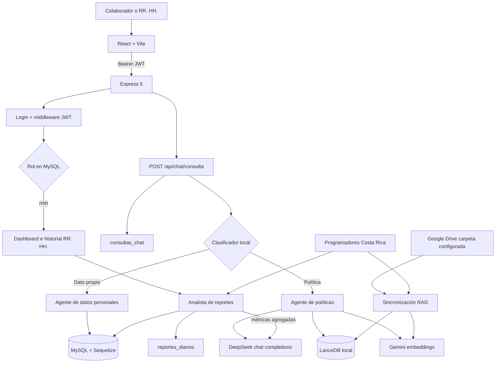

# Arquitectura de Impulso Creativo

## Diagrama lógico

## Componentes y responsabilidades

| Capa | Componentes reales | Responsabilidad |
| --- | --- | --- |
| Presentación | `frontend/src/App.jsx`, `api.js`, CSS | Login, chat, citas, historial, reportes individuales y dashboard RR. HH. |
| API | Express en `backend/src/app.js` y rutas | Valida JSON, expone endpoints y aplica middleware. |
| Identidad | `authController`, `authToken`, `autenticacion` | bcrypt, JWT HS256, expiración y carga del rol actual desde MySQL. |
| Políticas | `politicasController`, `rag/recuperacion`, `services/deepseek` | Recupera fragmentos, aplica umbral, redacta respuesta y cita fuentes. |
| Datos personales | `datosPersonalesController`, `datosPersonales` | Consulta datos permitidos de la persona autenticada en MySQL. |
| Auditoría | `ConsultaChat`, `registroConsultas` | Guarda intención, agente, citas, estado, escalamiento y latencia. |
| Conocimiento | `rag/indexador`, `drive`, `extractores`, LanceDB | Descarga, extracción, chunking, embeddings e índices locales. |
| Operación | `rag/sincronizacion`, `analistaReportes` | Sincronización incremental, reportes diarios y programadores. |

## Límites de datos

- **Políticas:** documentos indexados de la carpeta Drive configurada; LanceDB guarda texto, metadatos y vectores de 768 dimensiones.
- **Datos personales:** tablas MySQL y solo el identificador que proviene del JWT. El cuerpo de la solicitud no identifica al usuario.
- **Dashboard:** agregados de MySQL guardados en `reportes_diarios`; evita diagnósticos, observaciones médicas, nombres y preguntas textuales en sus métricas globales.
- **IA externa:** Gemini recibe contenido de fragmentos o consultas para embeddings; DeepSeek recibe contexto RAG o el JSON agregado de indicadores. Las respuestas de reportes se validan y tienen respaldo local.

## Programación

| Tarea | Hora | Zona | Comportamiento |
| --- | --- | --- | --- |
| Sincronización Drive | 06:00 | America/Costa_Rica | Usa cursor Drive, reconciliación y bloqueo local. |
| Reporte diario | 07:00 | America/Costa_Rica | Calcula agregados y crea una fila idempotente por fecha. |
| Arranque tardío | Al iniciar backend | America/Costa_Rica | Intenta sincronización pendiente antes de iniciar el programador de reportes. |

La sincronización protege los fragmentos sin propiedad de carpeta verificable: no los borra en la primera reconciliación. Las eliminaciones posteriores solo afectan IDs previamente confirmados dentro de la carpeta configurada.
